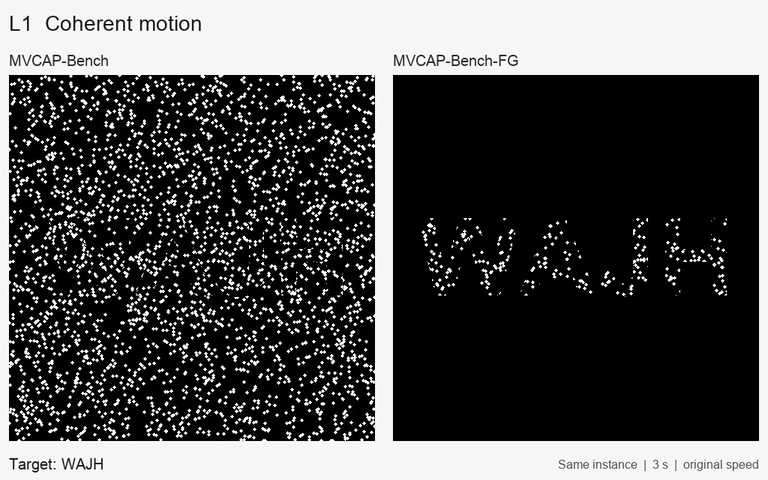
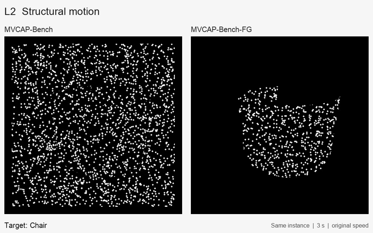
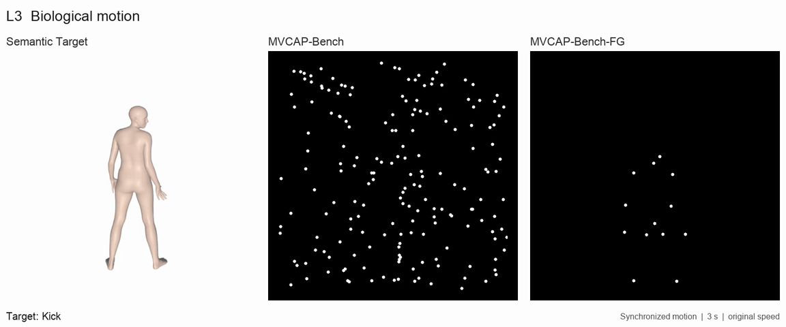

# MVCAP: Motion Vision CAPTCHA

Generation code for **Invisible in Space, Visible in Time: Motion Vision
CAPTCHA against GUI Agents** (ACM Multimedia 2026).

[Examples](#examples) · [Paper](https://doi.org/10.1145/3767308.3835234) ·
[Citation](CITATION.bib) · [Parameters](docs/PARAMETERS.md) ·
[Third-party resources](THIRD_PARTY.md) · [Validation](docs/VALIDATION.md)

MVCAP embeds a motion-defined foreground in dynamic background camouflage.
The three levels reveal four-character text through coherent motion (L1),
object structure through rotation (L2), and human action through point-light
biological motion (L3).

This repository provides the **L1/L2/L3 generators** and the matched
**foreground-only control (MVCAP-Bench-FG)**. It includes the main
`rigid_drift` condition and the existing `perturbed_drift` and `random_walk`
generation variants. The release is scoped to data generation; it does not
contain the benchmark video archive, browser frontends, or agent evaluation
runners.

## Examples

Read each row from left to right: **Semantic Target**, **MVCAP-Bench**, and
**MVCAP-Bench-FG**. The L2/L3 semantic targets animate in sync with the two
motion stimuli in a three-second loop at the original speed. L1 shows the
clean target text.

### L1 · Coherent motion: text



[View the 30 fps video](docs/examples/l1-main-vs-fg.mp4)

The seven-letter word **CAPTCHA** is a custom illustration generated for this
gallery. The standard L1 benchmark uses four-character targets.

### L2 · Structural motion: object



[View the 30 fps video](docs/examples/l2-main-vs-fg.mp4) ·
[Semantic target GIF](docs/examples/l2-semantic-target.gif)

### L3 · Biological motion: action



[View the 30 fps video](docs/examples/l3-main-vs-fg.mp4) ·
[Semantic target GIF](docs/examples/l3-semantic-target.gif)

These are illustrative stimuli; the benchmark presents each challenge as
a six-way matching task. See [sample details and source acknowledgments](docs/examples/README.md).
For access to the full offline benchmark, please contact
[zeyuzhang@sjtu.edu.cn](mailto:zeyuzhang@sjtu.edu.cn).

## Quick start: L1 and its foreground-only control

Use Python 3.10–3.12 and install FFmpeg with `libx264` support. Run all
commands from the repository root.

```bash
git clone https://github.com/zeyu1998/MVCAP.git
cd MVCAP
python -m venv .venv
source .venv/bin/activate
python -m pip install -r requirements.txt
ffmpeg -version

# A small generation run; use --num-samples 200 for the default dataset size.
python -m MVCAP_code.L1.generate_l1_dataset_rigid_drift --num-samples 3 --seed 42

# Regenerate the same semantic targets without the background carrier.
python -m ablation_study.A.generate_full_dataset --levels L1 --limit 3
python -m ablation_study.A.generate_vqa_files --levels L1
```

L1 outputs are written under `dataset/L1_text_dataset_rigid_drift/`.
FG outputs are written under
`ablation_study/A/datasets/L1_text_dataset_foreground_only/`.
The six-choice annotations contain explicit A–F labels and the correct label.

For Windows, activate the virtual environment with `.venv\Scripts\activate`.
FFmpeg must be on `PATH` on every platform. L1 searches standard system font
locations and falls back to Pillow's default font; install the same font on
each machine when comparing regenerated stimuli.

## Generate each level

| Level | Semantic target | Main generation guide | Additional local inputs |
|---|---|---|---|
| L1 | Four-character text | [L1 README](MVCAP_code/L1/README.md) | None |
| L2 | ShapeNet object category | [L2 README](MVCAP_code/L2/README.md) | Licensed ShapeNetCore archives |
| L3 | Human action | [L3 README](MVCAP_code/L3/README.md) | BABEL annotations, CMU/AMASS motion NPZs, neutral SMPL model |

Install `requirements-rendering.txt` for L2 and `requirements-l3.txt` for L3.
L2/L3 mesh rendering requires a working OpenGL context. On a Linux server
with an appropriate EGL/Mesa setup, set `PYOPENGL_PLATFORM=egl` **before**
starting Python. See the [pyrender offscreen-rendering guide](https://pyrender.readthedocs.io/en/latest/examples/offscreen.html)
for backend configuration.

The source inputs and model parameters must be obtained separately from
their official providers; see [THIRD_PARTY.md](THIRD_PARTY.md).

## Foreground-only generation

After generating the main data for the desired levels:

```bash
python -m ablation_study.A.generate_full_dataset --levels L1 L2 L3
python -m ablation_study.A.generate_vqa_files --levels L1 L2 L3
```

The FG generator retains source sample IDs, targets, and distractor metadata
while removing the dynamic background. Option assets remain in the main
dataset and are reused; they are not duplicated into the FG output folders.
See the [FG guide](ablation_study/A/README.md) for metadata paths and pairing.

## Reproducibility

- Default seed: `42`. Use a fresh output directory or `--overwrite` for a
  complete seeded regeneration; skipping existing videos changes which RNG
  draws are consumed for later videos.
- [docs/PARAMETERS.md](docs/PARAMETERS.md) records the main rendering parameters
  and entry points. Alternative motion regimes write to separate directories.
- The publication benchmark used fixed, curated samples. This source release
  regenerates stimuli and does not bundle that frozen media archive or its
  licensed selection inputs. L3 curation and any reduction to 200 samples
  must be performed explicitly on the generated pool.
- Rendering can vary with fonts, source-asset versions, OpenGL drivers, and
  FFmpeg. Seeded regeneration is not a promise of byte-identical reproduction
  of the previously rendered benchmark.
- Main and FG six-choice exports can have different choice orders. Always
  use the correct label belonging to the condition being evaluated.

Run the asset-free generation checks with:

```bash
python -m unittest discover -s tests -v
```

These exercise L1 video generation, cross-process seed reproducibility, FG
pairing, video decoding, and six-choice annotation semantics. L2/L3 rendering
also needs the separately acquired inputs and rendering dependencies.

## Repository layout

```text
MVCAP_code/L1/        Text generation and configuration
MVCAP_code/L2/        ShapeNet selection, thumbnails, and challenge generation
MVCAP_code/L3/        Motion selection, challenge/option rendering, quiz assembly
ablation_study/A/    Foreground-only generation and annotation export
ablation_study/common.py
docs/PARAMETERS.md
tests/
```

## License and citation

MVCAP code and documentation are released under the [MIT License](LICENSE).
Third-party datasets, model parameters, and separately installed software
retain their own terms; see [THIRD_PARTY.md](THIRD_PARTY.md).

If you use MVCAP in your research, please cite [CITATION.bib](CITATION.bib)
and the source resources used to generate your stimuli.
